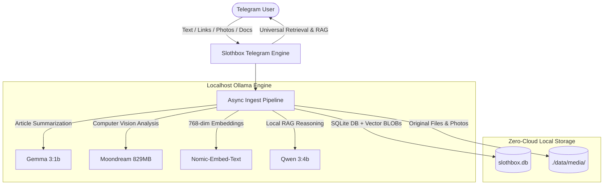

# 🦥 Slothbox

> **Save it. Forget it. Find it.**  
> A private, 100% local-first AI second brain that rewards radical laziness.  
> Built for **Hacktoberfest 2026** & the **DEV Challenge Week 3: Slow and Steady**.

[](https://opensource.org/licenses/MIT)
[](https://python.org)
[-brightgreen?logo=ollama)](https://ollama.com)
[](#-privacy--zero-mock-policy)
[](https://hacktoberfest.com)

---

## 💡 The Philosophy: Rewarding Radical Laziness

Traditional note-taking and bookmarking tools make a false promise: *they promise to organize your life, but first they demand your labor*. You have to create folders, assign tags, categorize bookmarks, and clean up messy notes.

**Slothbox flips this completely.** Inspired by International Sloth Day:
* You **never** organize anything manually.
* You **never** file things into folders or tag bookmarks.
* You simply forward or dump thoughts, web links, screenshots, whiteboards, or PDFs directly into your private Telegram chat and walk away.
* When you need something later, Slothbox retrieves the original file, answers questions across your notes with grounded RAG, or reads summaries out loud to you.

Best of all: **it runs 100% locally on a standard consumer laptop**. No OpenAI subscriptions, no cloud API fees, and zero personal data leaving your machine.

---

## 🏗️ Architecture



---

## 🧠 Open-Weight Model Roster

Slothbox is engineered to run on modest consumer hardware (~6 GB system RAM) using lightweight open-weight models:

| Role | Model | Size | Purpose |
| :--- | :--- | :--- | :--- |
| **Vision** | `moondream` | ~829 MB | Analyzes screenshots, diagrams, and posters without GPU overhead |
| **Summarizer** | `gemma3:1b` | ~815 MB | Fast, structured 2-line summaries and automatic `#tag` extraction |
| **Embeddings** | `nomic-embed-text` | ~274 MB | High-quality 768-dimensional vectors for semantic cosine similarity |
| **Local RAG** | `qwen3:4b` | ~2.5 GB | Grounded reasoning over stored context notes with exact citations |

---

## ✨ Features

### 1. Ingest Everything, Organize Nothing
* 📝 **Text Notes:** Drop thoughts, meeting notes, or code snippets; Slothbox auto-summarizes and tags them.
* 🔗 **Web Links:** Send any URL; Slothbox scrapes readable text, archives an offline copy, and generates a summary.
* 📸 **Photos & Diagrams:** Forward screenshots or whiteboard photos; `moondream` extracts visual context. Optional custom captions fuse manual intent with vision analysis.
* 📄 **Documents:** PDFs, Markdown, and text files are saved to disk and indexed.

### 2. Universal Reclaimability (`/get`)
Unlike typical note apps where attachments get compressed or lost, Slothbox guarantees **100% asset retrieval**:
* `/get <image_id>` — Sends back the **original, uncompressed photo**.
* `/get <doc_id>` — Uploads and returns the **original PDF/document file**.
* `/get <url_id>` — Delivers a clickable browser card with reader options.
* `/read <id>` — Displays clean, ad-free reader mode directly in Telegram.

### 3. Ask Your Stash (`/ask`)
Ask natural-language questions across your stored notes:
```text
User: /ask When do we need to renew the AWS certificates and what version is Postgres?
Slothbox: We renew AWS SSL certificates before Friday (the release day) and the Postgres version is 16. [Item #7]
[ 📥 #7 ]
```

### 4. Semantic Search (`/search`)
Search by concept rather than exact keyword matches using local cosine similarity:
```text
User: /search database release
Slothbox: 
1. #7 (Similarity: 63%)
   Ensure timely renewal of AWS SSL certificates and database migration to PostgreSQL 16 for a smooth deployment.
   #security #database #migration #aws #ssl | 2026-10-23
   [ 📥 #7 Get ] [ 🗄️ #7 Archive ]
```

### 5. Hands-Free Audio Summaries (`/voice`)
Too lazy to read? Tap `[ 🎙️ Listen ]` or send `/voice <id>` to synthesize a high-fidelity voice memo via ElevenLabs directly to Telegram.

### 6. Forgotten Note Resurfacing (`/digest`)
Slothbox surfaces forgotten items saved more than 7 days ago with 1-tap `Keep` or `Archive` buttons.

---

## 🕹️ Telegram Command Directory

| Command | Short Description |
| :--- | :--- |
| `/start` | Application overview, instructions & interactive quick buttons |
| `/help` | Complete command directory and usage guide |
| `/search <query>` | Semantic vector search across your notes, links & images |
| `/ask <question>` | 🧠 Local RAG AI answers questions using your stored notes |
| `/get <id>` | 📥 Retrieve original photo, document, link card, or note |
| `/read <id>` | 📖 Read clean, distraction-free article text in Telegram |
| `/recent` | List last 5 saved items with 1-tap action buttons |
| `/stats` | Stash analytics: total items, type breakdown, and top tags |
| `/save <text>` | Manually save a text note (same as sending directly) |
| `/digest` | Resurface a forgotten note saved >7 days ago |
| `/keep <id>` | Keep a resurfaced item active in your vault |
| `/archive <id>` | Archive an item out of active search & digest queries |
| `/voice <id>` | Generate a realistic AI voice memo (ElevenLabs) |

---

## 🔒 Privacy & Zero-Mock Policy

1. **Zero Cloud Leaks:** Your database (`slothbox.db`), media files (`./data/media/`), and vector embeddings stay strictly on your local machine.
2. **Single-User Security:** Whitelist authorization ensures only your verified numeric Telegram User ID can access the bot.
3. **Zero-Mock Guarantee:** Slothbox contains zero synthetic fallbacks. If Ollama or the embedding model is unreachable, Slothbox reports the failure transparently rather than fabricating fake search results.

---

## 🚀 Getting Started

### 1. Prerequisites
* **Python 3.10+**
* [Ollama](https://ollama.com) installed and running locally

### 2. Pull Local Models
```bash
ollama pull gemma3:1b
ollama pull moondream
ollama pull nomic-embed-text
ollama pull qwen3:4b
```

### 3. Clone & Install
```bash
git clone https://github.com/TejasRawool186/Slothbox.git
cd Slothbox
pip install -r requirements.txt
```

### 4. Configure Environment
```bash
# On Windows:
copy .env.example .env
# On Linux/macOS:
cp .env.example .env
```
Edit `.env` with your credentials:
* `TELEGRAM_BOT_TOKEN`: Your token from [@BotFather](https://t.me/BotFather)
* `TELEGRAM_ALLOWED_USER_ID`: Your numeric Telegram ID from [@userinfobot](https://t.me/userinfobot)

### 5. Run the Automated Tests
```bash
pytest tests/
```
All 26 unit and acceptance tests should pass.

### 6. Start the Bot
```bash
python -m src.bot
```

---

## 📜 License

Distributed under the [MIT License](LICENSE). Copyright (c) 2026 Tejas Rawool.
