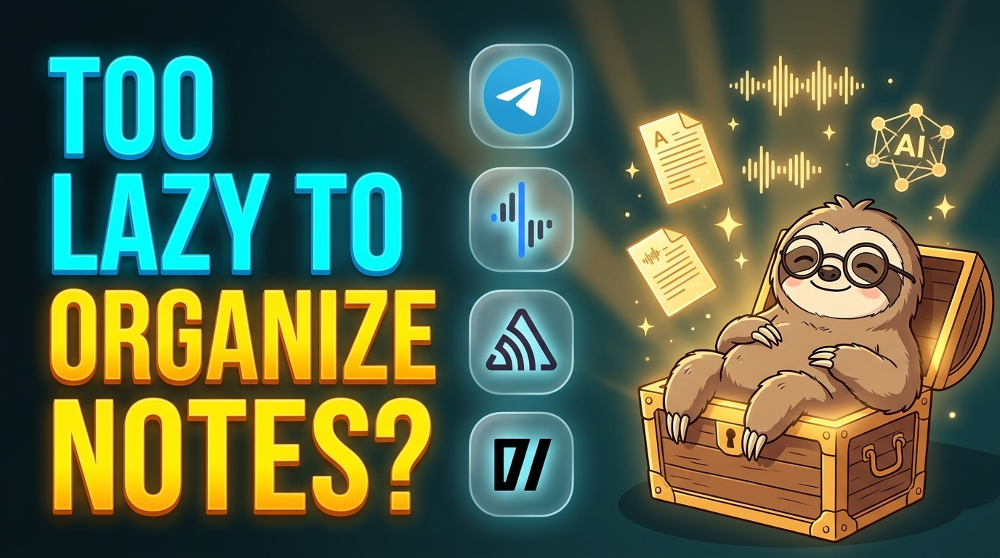
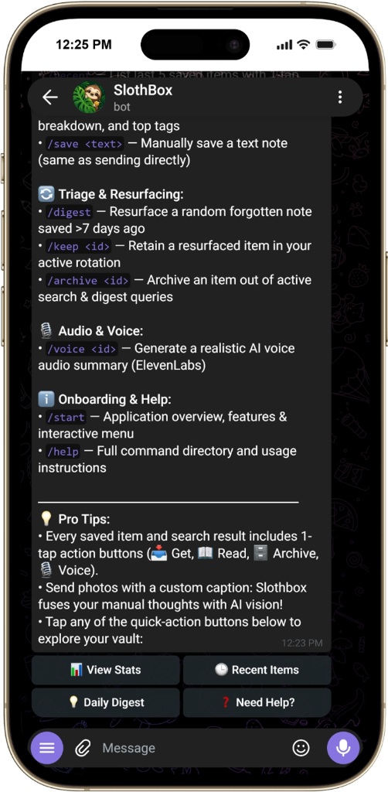
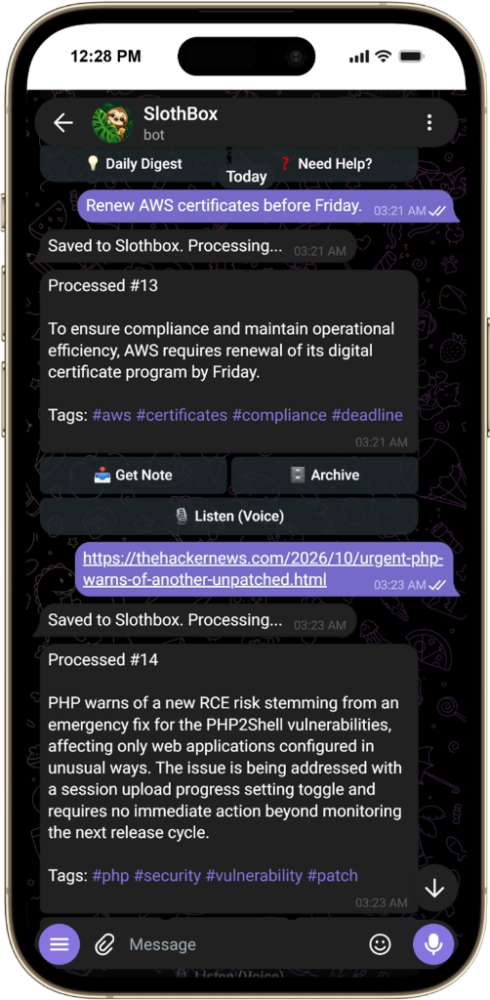
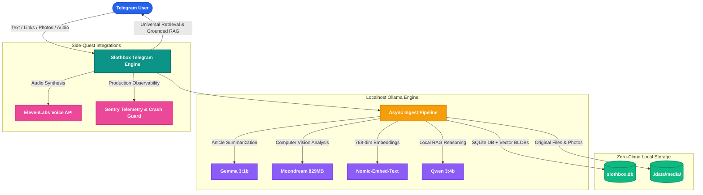

# 🦥 Slothbox

> **Save it. Forget it. Find it.**  
> A private, 100% local-first AI second brain that rewards radical laziness.  
> Built for **Hacktoberfest 2026** and the **DEV Challenge Week 3: Slow and Steady**.

[](https://youtu.be/xS2AdZFCUxA)
[](LICENSE)
[](https://python.org)
[-brightgreen?logo=ollama)](https://ollama.com)
[](#privacy-and-zero-mock-policy)
[](https://hacktoberfest.com)

---

## Video Walkthrough

[](https://youtu.be/xS2AdZFCUxA)

> **Direct Link:** Watch the complete architecture walkthrough and live Telegram demo on YouTube:  
> **[https://youtu.be/xS2AdZFCUxA](https://youtu.be/xS2AdZFCUxA)**

---

## The Problem: The Collector's Fallacy and Note Graveyards

Knowledge workers, researchers, and developers encounter high-value information every hour: technical documentation, architecture sketches, bug fixes, whitepapers, and bookmarks. Yet modern note-taking systems fail users in three fundamental ways:

1. **The Friction Tax:** Tools such as Notion, Obsidian, or Evernote demand upfront manual labor. You must create pages, assign categories, tag documents, and manage databases. Because of this administrative friction, people stop maintaining their vaults.
2. **The Knowledge Graveyard:** Unorganized notes become impossible to locate. Standard keyword search breaks the moment you cannot remember the exact phrasing or file name used weeks earlier.
3. **The Privacy and Cost Tax:** Cloud second brains upload personal notes, confidential screenshots, and proprietary code to third-party cloud providers, while locking your data behind expensive monthly subscriptions.

### The Solution: Radical Laziness Meets 100% Local AI 🦥

Slothbox eliminates manual organization entirely:
* **Zero Manual Filing:** You never create folders, tag bookmarks, or structure notes.
* **Frictionless Ingestion:** Forward a raw link, send a quick text thought, drop a PDF, or snap a photo of a whiteboard directly into Telegram.
* **Autonomous Local Processing:** Slothbox scrapes web content, runs computer vision analysis, generates concise summaries, extracts automatic hashtags, and stores 768-dimensional vector embeddings on your own machine.
* **Instant Grounded Retrieval:** Search your knowledge base using conceptual natural language, ask questions with cited local RAG, or receive realistic voice summaries.

---

## Live Mobile Interface

<p align="center">
  
  &nbsp;&nbsp;
  
</p>

---

## System Architecture

Slothbox operates as an offline-first pipeline orchestrated through Telegram, powered entirely by local open-weight models and an embedded SQLite vector store:



---

## Open-Weight Model Roster

Slothbox is optimized to run smoothly on standard consumer hardware (approximately 6 GB system RAM) using lightweight open-weight models:

| Role | Model | Size | Purpose |
| :--- | :--- | :--- | :--- |
| **Vision Analysis** | `moondream` | ~829 MB | Analyzes screenshots, diagrams, and posters without heavy GPU requirements |
| **Summarizer** | `gemma3:1b` | ~815 MB | Fast, structured 2-line summaries and automatic hashtag extraction |
| **Embeddings** | `nomic-embed-text` | ~274 MB | 768-dimensional local vector embeddings for semantic cosine similarity |
| **Local RAG** | `qwen3:4b` | ~2.5 GB | Grounded reasoning over stored context notes with exact item citations |

---

## Core Technologies and Side-Quest Implementations

Slothbox combines local open-weight artificial intelligence with production-grade tooling:

* **Telegram Bot API (python-telegram-bot):** Provides an instantaneous, cross-platform interface across mobile, tablet, and desktop with zero friction and interactive inline keyboard buttons.
* **Ollama Runtime:** Runs quantized open-weight models locally on CPU or GPU with zero cloud API dependencies.
* **Local SQLite Vector Storage:** Eliminates external vector database daemons by storing 768-dimensional float32 vector BLOBs directly alongside relational metadata in `slothbox.db`, computing cosine similarity in-process with pure Python and NumPy.
* **ElevenLabs Voice AI:** Generates realistic audio voice notes (`/voice <id>`) for hands-free listening while commuting or exercising.
* **Sentry Production Observability:** Implements full error tracing, automated crash isolation, and performance monitoring via the official Sentry Python SDK.
* **BeautifulSoup4 and Readability:** Cleans web articles, removes ads and boilerplate, and generates clean offline reader cards (`/read <id>`).

---

## Key Features

### 1. Ingest Everything, Organize Nothing
* **Text Notes:** Send thoughts, meeting minutes, or code snippets; Slothbox auto-summarizes and assigns tags.
* **Web Links:** Send any URL; Slothbox extracts readable text, archives an offline copy, and indexes the content.
* **Photos and Diagrams:** Forward screenshots, error messages, or whiteboard photos; `moondream` extracts visual details. Custom captions are fused with AI vision analysis.
* **Documents:** PDFs, Markdown files, and plain text documents are stored in `./data/media/` and indexed into the vector vault.

### 2. Universal Reclaimability (`/get`)
Unlike systems where attachments become compressed or lost, Slothbox guarantees complete asset retrieval:
* `/get <id>` sends back the original, uncompressed photo or original document.
* `/read <id>` delivers clean, ad-free reader mode directly within Telegram.

### 3. Grounded Retrieval-Augmented Generation (`/ask`)
Query your vault using natural language with verified source citations:
```text
User: /ask When do we need to renew the AWS certificates and what version is Postgres?
Slothbox: We renew AWS SSL certificates before Friday (the release day) and the Postgres version is 16. [Item #13]
```

### 4. Semantic Search (`/search`)
Search by concepts and ideas rather than exact keyword matches:
```text
User: /search database security
Slothbox: 
1. #13 (Similarity: 78%)
   AWS requires renewal of its digital certificate program by Friday to ensure compliance.
   #aws #certificates #compliance #deadline | 2026-10-25
   [ Get Note ] [ Archive ] [ Listen (Voice) ]
```

### 5. Audio Voice Summaries (`/voice`)
Generate realistic audio voice memos on demand powered by ElevenLabs voice synthesis.

### 6. Forgotten Note Resurfacing (`/digest`)
Slothbox periodically surfaces forgotten items saved more than 7 days ago with one-tap `Keep` or `Archive` actions.

---

## Telegram Command Directory

| Command | Short Description |
| :--- | :--- |
| `/start` | Application overview, feature directory, and interactive menu |
| `/help` | Detailed command directory and usage instructions |
| `/search <query>` | Semantic vector search across your notes, links, and images |
| `/ask <question>` | Local RAG AI answers questions grounded in your stored notes |
| `/get <id>` | Retrieve original uncompressed photo, document, or link card |
| `/read <id>` | Read clean, distraction-free article text inside Telegram |
| `/recent` | List the last 5 saved items with 1-tap action buttons |
| `/stats` | Vault analytics: item counts, type breakdown, and top tags |
| `/save <text>` | Manually save a text note (same as sending directly) |
| `/digest` | Resurface a forgotten note saved more than 7 days ago |
| `/keep <id>` | Retain a resurfaced item in your active rotation |
| `/archive <id>` | Archive an item out of active search and digest queries |
| `/voice <id>` | Generate a realistic AI voice audio summary (ElevenLabs) |

---

## Privacy and Zero-Mock Policy

1. **Zero Cloud Leaks:** Your database (`slothbox.db`), media assets (`./data/media/`), and vector embeddings reside exclusively on your physical machine.
2. **Single-User Whitelist Security:** Access is strictly limited to your verified numeric Telegram User ID. Unauthorized messages are rejected.
3. **Zero-Mock Guarantee:** Slothbox contains no synthetic mock fallbacks in production. If Ollama or the local embedding model is offline, Slothbox reports the condition explicitly instead of fabricating synthetic search results.

---

## Quickstart Guide

### 1. Prerequisites
* **Python 3.10+**
* [Ollama](https://ollama.com) installed and running locally

### 2. Pull Local Open-Weight Models
```bash
ollama pull gemma3:1b
ollama pull moondream
ollama pull nomic-embed-text
ollama pull qwen3:4b
```

### 3. Clone Repository and Install Dependencies
```bash
git clone https://github.com/TejasRawool186/Slothbox.git
cd Slothbox
pip install -r requirements.txt
```

### 4. Configure Environment
```bash
# On Windows:
copy .env.example .env

# On Linux or macOS:
cp .env.example .env
```

Configure your credentials in `.env`:
* `TELEGRAM_BOT_TOKEN`: Your token obtained from [@BotFather](https://t.me/BotFather)
* `TELEGRAM_ALLOWED_USER_ID`: Your numeric Telegram user ID from [@userinfobot](https://t.me/userinfobot)
* `ELEVENLABS_API_KEY`: (Optional) Your API key for voice notes
* `SENTRY_DSN`: (Optional) Sentry DSN for performance and crash monitoring

### 5. Run the Automated Test Suite
```bash
pytest tests/
```
All 26 unit and acceptance tests execute and validate local functionality.

### 6. Start Slothbox 🦥
```bash
python -m src.bot
```

---

## Hacktoberfest 2026 Participation

Slothbox is submitted as an open-source project for **Hacktoberfest 2026** and the **DEV Challenge Week 3: Slow and Steady**, celebrating International Sloth Day with local, sustainable, and distraction-free personal software.

* **GitHub Repository:** [https://github.com/TejasRawool186/Slothbox](https://github.com/TejasRawool186/Slothbox)
* **Video Walkthrough:** [https://youtu.be/xS2AdZFCUxA](https://youtu.be/xS2AdZFCUxA)
* **Developer Community Profile:** [https://dev.to/tejasrawool186](https://dev.to/tejasrawool186)

---

## License

Distributed under the [MIT License](LICENSE). Copyright (c) 2026 Tejas Rawool.
