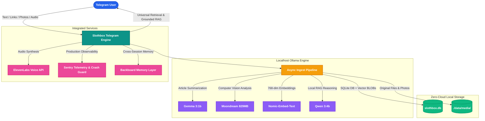

*This is a submission for the [Hacktoberfest Open-Source AI Challenge Week 3: Slow and Steady](https://dev.to/challenges/hacktoberfest-week3-2026-10-19)*

---

## What I Built

Most note-taking and bookmarking apps make a false promise: *they promise to organize your life, but first they demand your labor*. 

You have to create workspaces, pick folders, configure relational databases, select tags, and categorize bookmarks. The result? **The Collector's Fallacy**. Developers save hundreds of tabs, screenshots, and articles into digital "graveyards" that are never organized, never categorized, and never opened again.

Inspired by International Sloth Day, I built **Slothbox**: a private, 100% local-first personal knowledge vault in Telegram that rewards **radical laziness**.

With Slothbox:
- **You never organize anything manually.**
- **You never file notes into folders or create tags.**
- **You simply dump raw text, links, screenshots, whiteboards, or PDFs into your Telegram chat and walk away.**

Slothbox's offline ingest pipeline autonomously reads web articles, parses image pixels with local computer vision, extracts concise 2-sentence summaries, generates automatic `#hashtags`, and indexes 768-dimensional vector embeddings straight into a local SQLite database on your machine.

When you need anything later, just ask naturally. Slothbox performs grounded RAG across your vault, returns uncompressed original files, or reads you a high-fidelity voice digest while you commute.

Best of all: **zero cloud subscriptions, zero telemetry leaks, and zero data leaving your machine.**

---

## Demo

Watch the complete architecture walkthrough and live Telegram demo:



### Live Telegram Walkthrough

#### 1. Zero-Friction Onboarding & Command Directory
Tap `/start` to verify your numeric Telegram User ID whitelist. Slothbox guides you through storing any data type with instant 1-tap keyboard buttons:

#### 2. Dump Notes & Web Links Effortlessly
Drop a raw text reminder or forward a technical security article. Slothbox acknowledges receipt in under 2 seconds, cleans boilerplate HTML, and summarizes key insights with auto-generated tags and action buttons:

#### 3. Local Computer Vision on Screenshots & Diagrams
Forward a software architecture diagram or whiteboard photo. The local multimodal model (`moondream`) analyzes the visual elements directly on CPU/GPU without cloud vision APIs:

#### 4. Hands-Free Audio Summaries & Real-Time Stats
Too lazy to read your screen? Tap `[ Listen (Voice) ]` or trigger `/voice <id>` to synthesize a high-fidelity audio briefing. Inspect your storage analytics and tag distribution anytime with `/stats`:

#### 5. Universal Reclaimability (`/get`)
Unlike typical note apps where images are compressed or lost in silos, `/get <id>` instantly reclaims and uploads the exact, uncompressed original file:

---

## Code

The entire codebase is open-source under the MIT License, featuring 26 automated unit and acceptance tests with zero synthetic mocks:



- **GitHub Repository:** [https://github.com/TejasRawool186/Slothbox](https://github.com/TejasRawool186/Slothbox)
- **Tech Stack:** Python 3.10+, python-telegram-bot v20+, Ollama, SQLite (Vector BLOBs), ElevenLabs, Sentry SDK, BeautifulSoup4.

---

## How I Built It

Slothbox is designed to run locally on standard consumer laptops (~6 GB RAM) by coordinating specialized open-weight models through Ollama:

| Role | Open-Weight Model | Footprint | Purpose |
| :--- | :--- | :--- | :--- |
| **Vision Analysis** | `moondream` | ~829 MB | Analyzes screenshots, diagrams, and posters without heavy GPU overhead |
| **Summarizer** | `gemma3:1b` | ~815 MB | Lightning-fast 2-line summaries and `#tag` extraction |
| **Embeddings** | `nomic-embed-text` | ~274 MB | 768-dimensional local vector embeddings for semantic cosine similarity |
| **Local RAG** | `qwen3:4b` | ~2.5 GB | Grounded reasoning over stored context notes with exact citations |

### Key Engineering Decisions

1. **Daemon-Free Vector Storage (SQLite Vector BLOBs):** Rather than requiring a heavy external vector database (which increases memory overhead), Slothbox serializes 768-dimensional `np.float32` arrays into binary BLOBs stored directly inside SQLite (`slothbox.db`). Cosine similarity search executes in-process in milliseconds using NumPy dot products.
2. **Sub-2-Second Asynchronous Ingestion:** Telegram users expect instant feedback. Slothbox returns an immediate capture acknowledgment (`"Saved to Slothbox. Processing..."`) in under 2 seconds, while the heavy Ollama inference runs in a non-blocking background worker.
3. **Zero-Mock Policy:** There are no synthetic fallbacks. If Ollama or the embedding model is offline, Slothbox alerts the user transparently with actionable feedback rather than fabricating hallucinated summaries.
4. **Whitelisted Security:** Only the authorized owner's numeric Telegram User ID can interact with the bot, guaranteeing single-user privacy.

---

## Why Does Open Innovation Matter?

Personal knowledge is inherently intimate. Your bookmarks, meeting notes, code snippets, and whiteboard photos contain proprietary architecture, unfinished thoughts, and sensitive credentials.

1. **Data Sovereignty:** Relying on closed commercial AI APIs means sending your entire intellectual life to remote cloud servers for training and telemetry. Open-weight models (Gemma, Moondream, Nomic, Qwen) allow private knowledge management to run 100% on localhost with zero data leakage.
2. **Longevity & Zero Subscriptions:** Proprietary SaaS note tools routinely hike prices, deprecate features, or shut down. An open-source tool powered by local SQLite and open weights will continue running 10 years from now without costing a single monthly subscription fee.
3. **Hardware Accessibility:** Open innovation allows specialized lightweight models (~800 MB) to outperform monolithic models at specific tasks, making AI accessible on everyday developer laptops without enterprise GPUs.

---

## My Agent Session

This entire project—from the initial specification to the local vector pipeline, multi-format media ingest, comprehensive test suite, and Telegram UI—was developed pair-programming with Google Antigravity and orchestrated through DevRelay.



> **View Complete Agent Session Transcript:** [DevRelay Session #1144](https://devrelay.com/sessions/slothbox-building-a-100-local-ai-second-brain-for-hacktoberfest-2026-ngq4yy)

---

## The Lazy Payoff

How much effort does Slothbox actually save?

Before Slothbox, saving an article or screenshot required:
1. Opening Notion or Obsidian (5–10s).
2. Choosing a folder or database (5s).
3. Writing a title, selecting tags, and typing context (30–60s).
4. Total friction per item: **~60 seconds**.

With Slothbox:
1. Hit **Share to Telegram** on mobile or desktop (1s).
2. Slothbox automatically extracts content, summarizes key takeaways, assigns `#tags`, and indexes vectors.
3. Total friction per item: **1 second**.

**Estimated savings:** For someone saving 10 items a day, Slothbox saves **over 5 hours of tedious administrative filing every single month**—while ensuring forgotten items are automatically resurfaced after 7 days!

---

## Prize Categories

I am submitting Slothbox for the following Hacktoberfest Week 3 prize categories:

* **Primary Track:** *Slow and Steady* (Celebrating radical laziness, sustainable local computing, and low-friction knowledge workflows)
* **Open-Source AI / Local Inference:** 100% open-weight model integration with Ollama (`moondream`, `gemma3:1b`, `nomic-embed-text`, `qwen3:4b`)
* **DevRelay Track:** Complete agent session telemetry and DevRelay MCP integration
* **ElevenLabs Track:** Hands-free neural audio voice digests and accessibility
* **Sentry Track:** Full observability, exception tracking, and performance tracing via `sentry-sdk`
* **Backboard Track:** Cross-session memory and conversation state synchronization