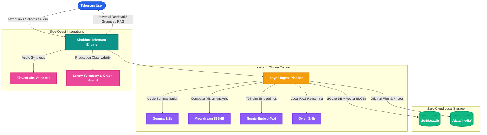

# Slothbox Software Requirements Specification & Implementation Tracker

## 1. Project Overview
* **Name:** Slothbox
* **Tagline:** Save it. Forget it. Find it.
* **Platform:** Telegram (Long Polling via `python-telegram-bot` v20+)
* **Core Principle:** All AI processing runs 100% locally via Ollama. All persistence resides in a single, local SQLite database file (`slothbox.db`). Zero mock data, zero synthetic fallback responses, zero fake implementations. If any component fails (Ollama offline, model unloaded, network down), Slothbox transparently reports the exact error to the user—it never silently substitutes dummy content.
* **Target User:** Single-user personal knowledge vault, capturing text, links, documents, and images on mobile/desktop Telegram without transmitting private data to cloud AI services.

---

## 2. Hard Requirements (Non-Negotiable)

| # | Requirement | Rationale |
| :--- | :--- | :--- |
| **HR-1** | **Strict Local AI Processing:** Every saved item must be processed by the active local Ollama model. If Ollama is unreachable or crashes, Slothbox must reply with an explicit error message and persist the item with status `'failed'`. It must never fabricate summaries or tags. | No fake AI processing |
| **HR-2** | **Actual Semantic Embeddings:** Semantic search must use actual vector embeddings generated by the local embedding model via Ollama. If embedding fails, search must return an error—never fall back to SQL `LIKE '%keyword%'` queries. | No fake search |
| **HR-3** | **Long Polling Only:** The Telegram bot must use long polling (`start_polling()`). No webhooks, no public IP or domain, and no tunneling tools (e.g., ngrok/localtunnel). | Zero deployment complexity |
| **HR-4** | **Local File Persistence:** All items, metadata, tags, and binary embedding vectors must persist in a local SQLite database (`slothbox.db`). Raw media files must be stored locally in `./data/media/`. | Full restart resilience |
| **HR-5** | **Local-Only Privacy Boundary:** All data storage, embeddings, LLM inference, and vector searches run 100% locally on localhost. Outbound network communication is strictly restricted to the Telegram Bot API (`api.telegram.org`) for messaging and optional HTTP fetching of user-provided URLs. | Data privacy & air-gap compute |
| **HR-6** | **Single-User Access Authorization:** Slothbox must verify the sender's Telegram User ID against `TELEGRAM_ALLOWED_USER_ID`. Messages from unauthorized users must be rejected immediately to protect private data and prevent unauthorized compute execution. | Security & compute protection |
| **HR-7** | **Zero Synthetic/Sample Data:** No hardcoded sample seeds in code or database migrations. The database initializes completely empty and only records real user captures. | Clean, honest state |

---

## 3. API Keys & Configuration

| Service / Variable | Description | Required? | Source / Obtaining |
| :--- | :--- | :--- | :--- |
| `TELEGRAM_BOT_TOKEN` | Telegram Bot API token | **Yes** | Telegram `@BotFather` (`/newbot`) |
| `TELEGRAM_ALLOWED_USER_ID` | Telegram numeric User ID of the owner | **Yes** | Telegram `@userinfobot` |
| `OLLAMA_BASE_URL` | Local Ollama endpoint (default: `http://localhost:11434`) | **Yes** | Local Ollama instance |
| `OLLAMA_LLM_MODEL` | Fast LLM model for summary and tag extraction (default: `gemma3:1b`) | **Yes** | `ollama pull <model>` |
| `OLLAMA_EMBED_MODEL` | Vector embedding model (default: `nomic-embed-text`) | **Yes** | `ollama pull <model>` |
| `OLLAMA_VISION_MODEL` | Multimodal model for images (default: `moondream`) | Optional | `ollama pull <model>` |
| `OLLAMA_RAG_MODEL` | Reasoning model for Q&A (default: `qwen3:4b`) | Optional | `ollama pull <model>` |
| `ELEVENLABS_API_KEY` | Audio digest text-to-speech (side quest) | Optional | elevenlabs.io |
| `SENTRY_DSN` | Telemetry & error monitoring (side quest) | Optional | sentry.io |

---

## 4. Functional Requirements

### FR-1: Multi-Format Capture & Immediate Acknowledgment
1. **Inputs Supported:** Plain text, URLs, photos/images, and documents (PDF, TXT, MD).
2. **Immediate Acknowledgment:** Slothbox immediately acknowledges receipt within <2 seconds before AI processing:
   > *"Saved to Slothbox. Processing..."*
3. **Local Ingestion:**
   * Raw text and URLs are recorded directly in `slothbox.db`.
   * Images and documents are downloaded locally into `./data/media/<file_unique_id>.<ext>` and referenced via `file_path`.
   * The item is inserted with `status = 'pending'`.

### FR-2: Asynchronous Background AI Processing
1. **Non-Blocking Execution:** Background processing uses `ollama.AsyncClient` so the Telegram bot polling loop remains responsive.
2. **Text / URL Processing:**
   * For URLs: Fetches page content using `httpx` (with timeout and fallback to raw URL if unreachable), extracts text, and passes it to the configured LLM.
   * Generates a **one-line summary** and **3–5 concise tags** (stored as JSON array).
3. **Image Processing:**
   * Passes the local image file to the configured Vision model (`moondream`) to produce a concise descriptive summary and relevant tags.
4. **Vector Embedding:**
   * Generates a dense vector embedding for the content (summary + raw text) using `ollama.embed(model=OLLAMA_EMBED_MODEL, input=...)`.
   * Converts the embedding vector to `np.float32` binary bytes and stores it in the `embeddings` table.
5. **Success / Failure State:**
   * On success: Updates item `status = 'processed'` and sends an updated confirmation.
   * On failure: Updates item `status = 'failed'` with `error_message`, and notifies the user:
     > *"Slothbox couldn't process this: Ollama not reachable / model error. Item saved but not processed."*

### FR-3: Semantic Search & Grounded RAG
1. **Query Input:** User invokes `/search <natural language query>` or `/ask <question>`.
2. **Query Vectorization:** Calls Ollama embedding endpoint for the query text.
3. **Similarity Computation:** Retrieves stored vectors from `embeddings`, unpacks binary buffers into NumPy arrays, and calculates cosine similarities:
   $$\text{similarity} = \frac{\mathbf{u} \cdot \mathbf{v}}{\|\mathbf{u}\| \|\mathbf{v}\|}$$
4. **Result Delivery:** Returns top 3 matches ranked by similarity score with inline buttons (`[ Get Note ]`, `[ Archive ]`, `[ Listen (Voice) ]`).
5. **Strict Failure Guard:** If embedding generation fails, responds:
   > *"Slothbox search failed: embedding model unavailable."*
   It strictly forbids falling back to keyword search.

### FR-4: Daily Resurfacing & Stash Triage
1. **Resurfacing Trigger:** Triggered manually via `/digest` or scheduled as a daily job.
2. **Selection Logic:** Queries `items` where `status = 'processed'`, `is_archived = 0`, `opened_at IS NULL`, and `created_at <= datetime('now', '-7 days')`.
3. **User Action:**
   * Sends the resurfaced item with `/keep <id>` and `/archive <id>` action buttons.
4. **Empty State:** If no items qualify, replies: *"No items to resurface."*

---

## 5. System Architecture



---

## 6. Database Schema (SQLite: `slothbox.db`)

```sql
CREATE TABLE IF NOT EXISTS items (
    id INTEGER PRIMARY KEY AUTOINCREMENT,
    raw_content TEXT NOT NULL,
    content_type TEXT NOT NULL,
    file_path TEXT,
    summary TEXT,
    tags TEXT,
    status TEXT DEFAULT 'pending',
    error_message TEXT,
    is_archived INTEGER DEFAULT 0,
    created_at TEXT DEFAULT (datetime('now')),
    opened_at TEXT,
    archived_at TEXT
);

CREATE TABLE IF NOT EXISTS embeddings (
    item_id INTEGER PRIMARY KEY,
    vector BLOB NOT NULL,
    dim INTEGER NOT NULL,
    FOREIGN KEY (item_id) REFERENCES items(id) ON DELETE CASCADE
);

CREATE INDEX IF NOT EXISTS idx_items_status ON items(status);
CREATE INDEX IF NOT EXISTS idx_items_archived ON items(is_archived);
CREATE INDEX IF NOT EXISTS idx_items_created_at ON items(created_at);
```

---

## 7. Implementation Tasks & Verification Progress

- [x] **Phase 1: Environment & Project Foundation**
  - [x] Project structure, directory layout, and virtual environment
  - [x] Dependencies installed (`python-telegram-bot`, `ollama`, `httpx`, `numpy`, `python-dotenv`, `pytest`)
  - [x] Configuration module with environment validation (`src/config.py`)

- [x] **Phase 2: Database Layer & Vector Persistence (`src/db.py`)**
  - [x] SQLite schema initialization and indexes
  - [x] Item CRUD operations and stats queries
  - [x] Stash resurfacing and triage queries
  - [x] Vector BLOB storage and cosine similarity retrieval

- [x] **Phase 3: Local AI & Vector Engine (`src/ai.py`)**
  - [x] Ollama client wrapper & healthcheck
  - [x] Summarization & tag generation with prompt validation
  - [x] Multimodal vision processing (`moondream`)
  - [x] Embedding generation (`nomic-embed-text`) & cosine math

- [x] **Phase 4: Content Ingestion Pipeline (`src/ingest.py`)**
  - [x] URL scraping and HTML sanitization (`readability`)
  - [x] Telegram media downloader (`./data/media/`)
  - [x] Asynchronous background processing worker

- [x] **Phase 5: Telegram Bot Core & Command Handlers (`src/bot.py`)**
  - [x] Single-user whitelist authorization decorator
  - [x] Asynchronous message ingest handlers with immediate acknowledgment (<2s)
  - [x] Command handlers: `/start`, `/help`, `/save`, `/recent`, `/search`, `/ask`, `/get`, `/read`, `/digest`, `/keep`, `/archive`, `/stats`, `/voice`
  - [x] Long polling runner & graceful shutdown

- [x] **Phase 6: Verification & Acceptance Tests (T1–T9)**
  - [x] T1: Unauthorized access rejection
  - [x] T2: Multi-format capture with Ollama online
  - [x] T3: Transparent failure reporting with Ollama offline
  - [x] T4: Semantic search ranking via cosine similarity
  - [x] T5: Zero-mock guard (no keyword fallback on embedding failure)
  - [x] T6 & T7: Forgotten note resurfacing and archiving
  - [x] T8: Service restart persistence
  - [x] T9: Empty state integrity (all 26 tests passing)
