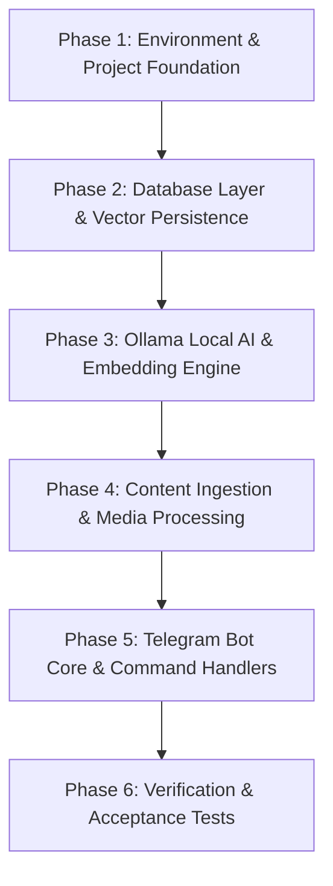

# Slothbox Implementation Tasks

> **Source Spec:** [srs.md](file:///d:/Slothbox/srs.md)  
> **Status:** Pending Execution  
> **Architecture Principle:** 100% Local AI (Ollama) + Local SQLite (`slothbox.db`) + Telegram Long Polling. Zero mock data, zero synthetic fallbacks.

---

## Task Overview & Phase Roadmap



---

## Phase 1: Environment & Project Foundation

- [x] **Task 1.1: Project Directory Structure**
  - Create directory layout:
    ```
    Slothbox/
    ├── data/
    │   └── media/          # Local storage for images and documents
    ├── src/
    │   ├── __init__.py
    │   ├── config.py       # Environment variable loader & validator
    │   ├── db.py           # SQLite manager & vector BLOB handlers
    │   ├── ai.py           # Ollama async inference & embedding client
    │   ├── ingest.py       # Content parser & HTTP/Media downloader
    │   └── bot.py          # Telegram bot handlers & dispatcher
    ├── tests/
    │   ├── test_db.py
    │   ├── test_ai.py
    │   └── test_ingest.py
    ├── .env.example
    ├── requirements.txt
    ├── srs.md
    └── task.md
    ```
  - Verification: Directory tree matches specification.

- [x] **Task 1.2: Dependencies & Virtual Environment**
  - Create `requirements.txt`:
    - `python-telegram-bot>=20.7`
    - `ollama>=0.3.0`
    - `httpx>=0.27.0`
    - `numpy>=1.26.0`
    - `python-dotenv>=1.0.0`
    - `pytest>=8.0.0` (for testing)
  - Verification: `pip install -r requirements.txt` executes cleanly.

- [x] **Task 1.3: Configuration Module (`src/config.py`)**
  - Create `.env.example` with documented keys.
  - Implement `Settings` class loading:
    - `TELEGRAM_BOT_TOKEN`: str (Required)
    - `TELEGRAM_ALLOWED_USER_ID`: int (Required)
    - `OLLAMA_BASE_URL`: str (Default: `"http://localhost:11434"`)
    - `OLLAMA_LLM_MODEL`: str (Default: `"gemma2:2b"`)
    - `OLLAMA_EMBED_MODEL`: str (Default: `"nomic-embed-text"`)
    - `OLLAMA_VISION_MODEL`: str (Default: `"llava"`)
    - Paths: `DB_PATH = "./data/slothbox.db"`, `MEDIA_DIR = "./data/media/"`
  - Verification: Validate missing mandatory variables raises `ValueError`.

---

## Phase 2: Database Layer & Vector Persistence (`src/db.py`)

- [x] **Task 2.1: SQLite Schema Initialization**
  - Implement `init_db(db_path)` executing migrations:
    - `items` table (`id`, `raw_content`, `content_type`, `file_path`, `summary`, `tags`, `status`, `error_message`, `is_archived`, `created_at`, `opened_at`, `archived_at`)
    - `embeddings` table (`item_id`, `vector` BLOB, `dim` INTEGER)
    - Indexes on `status`, `is_archived`, and `created_at`
  - Verification: Creates `slothbox.db` with proper tables and indexes.

- [x] **Task 2.2: Item CRUD Operations**
  - Implement:
    - `insert_item(raw_content, content_type, file_path=None) -> int`: Creates row with `status='pending'`.
    - `update_item_success(item_id, summary, tags)`: Sets `summary`, `tags` (JSON string), and `status='processed'`.
    - `update_item_failure(item_id, error_message)`: Sets `status='failed'`, `error_message`.
    - `get_item(item_id) -> Optional[dict]`
    - `get_recent_items(limit=5) -> list[dict]`
    - `get_stats() -> dict`: Total count, status counts, tag frequency.
  - Verification: Verify unit tests in `tests/test_db.py`.

- [x] **Task 2.3: Stash Resurfacing & Archiving Queries**
  - Implement:
    - `get_resurface_candidates(days=7, limit=1) -> list[dict]`: Active items (`is_archived=0`, `opened_at IS NULL`, `status='processed'`, `created_at <= 7 days ago`).
    - `mark_item_kept(item_id) -> bool`: Updates `opened_at = datetime('now')`.
    - `mark_item_archived(item_id) -> bool`: Updates `is_archived = 1`, `archived_at = datetime('now')`.
  - Verification: Backdated test item is returned; marking archived removes it from candidates.

- [x] **Task 2.4: Vector Storage & Retrieval**
  - Implement:
    - `save_embedding(item_id: int, vector: list[float] | np.ndarray)`: Serializes `np.float32` array to binary bytes.
    - `get_all_embeddings() -> list[tuple[int, np.ndarray]]`: Loads binary BLOBs and unpacks into NumPy 1D arrays with their corresponding `item_id`.
  - Verification: Roundtrip serialization produces matching array values and shapes.

---

## Phase 3: Local AI & Vector Engine (`src/ai.py`)

- [x] **Task 3.1: Ollama Client Wrapper & Healthcheck**
  - Initialize `ollama.AsyncClient(host=OLLAMA_BASE_URL)`.
  - Implement `check_ollama_health() -> tuple[bool, str]`: Validates connectivity and verifies models are downloaded.
  - Verification: Returns `True` when Ollama is running; `False` with error message when stopped.

- [x] **Task 3.2: Summarization & Tag Generation**
  - Implement `async generate_summary_and_tags(content: str, content_type: str) -> tuple[str, list[str]]`:
    - Strict prompt enforcing output structure:
      - Line 1: `SUMMARY: <one concise sentence>`
      - Line 2: `TAGS: <comma-separated 3-5 tags>`
    - Parsing logic with validation.
    - Error handling: Raises custom `OllamaProcessingError` on failure (strictly no placeholder text).
  - Verification: Returns real summary and list of tags.

- [x] **Task 3.3: Multimodal Vision Processing**
  - Implement `async describe_image(image_path: str) -> tuple[str, list[str]]`:
    - Sends local image to `OLLAMA_VISION_MODEL`.
    - Extracts concise descriptive summary and tags.
  - Verification: Image yields accurate visual description.

- [x] **Task 3.4: Embedding & Vector Similarity Search**
  - Implement `async generate_embedding(text: str) -> np.ndarray`:
    - Calls `ollama.embed(model=OLLAMA_EMBED_MODEL, input=text)`.
    - Returns normalized `np.ndarray(dtype=np.float32)`.
  - Implement `compute_top_similar(query_vector: np.ndarray, stored_embeddings: list[tuple[int, np.ndarray]], top_k=3) -> list[tuple[int, float]]`:
    - Cosine similarity: $\frac{\mathbf{u} \cdot \mathbf{v}}{\|\mathbf{u}\| \|\mathbf{v}\|}$
    - Returns sorted list of `(item_id, similarity_score)`.
  - Verification: Query embeddings rank relevant content highest.

---

## Phase 4: Ingestion & Processing Pipeline (`src/ingest.py`)

- [x] **Task 4.1: URL Content Fetching & Sanitization**
  - Implement `async fetch_url_content(url: str) -> str`:
    - Uses `httpx.AsyncClient` with a 10s timeout and User-Agent header.
    - Extracts meaningful title and readable text (stripping scripts/styles).
    - If URL fetching fails, returns original URL text for direct AI summarization.
  - Verification: Fetches readable text from web pages.

- [x] **Task 4.2: Telegram Media Downloader**
  - Implement `async download_telegram_file(file, destination_dir: str) -> str`:
    - Saves photos and documents to `./data/media/<unique_id>.<ext>`.
  - Verification: File successfully downloaded and persisted to disk.

- [x] **Task 4.3: Background Processing Worker**
  - Implement `async process_item_pipeline(item_id: int, db, ai_client)`:
    - Reads raw item from DB.
    - Routes to LLM / Vision model based on `content_type`.
    - Generates vector embedding of summary + content.
    - Saves summary, tags, and embedding to DB in transaction.
    - Updates item status to `'processed'`.
    - On error: Logs traceback, records `status='failed'`, sets `error_message`, and dispatches Telegram notification to owner.
  - Verification: Tested with mock-free Ollama running and stopped.

---

## Phase 5: Telegram Bot Core & Handlers (`src/bot.py`)

- [x] **Task 5.1: Telegram Application & Auth Middleware**
  - Build Telegram bot using `ApplicationBuilder().token(...).build()`.
  - Implement `@authorized_only` decorator:
    - Checks `update.effective_user.id == TELEGRAM_ALLOWED_USER_ID`.
    - If unauthorized: Silently ignores or sends `"Access Denied"` without writing to DB.
  - Verification: Messages from different user IDs are rejected immediately.

- [x] **Task 5.2: Message Ingestion Handlers**
  - Message handler for Text & URLs:
    - Returns immediate acknowledgment `<2s`: *"Saved to Slothbox. Processing..."*
    - Inserts `status='pending'` into SQLite.
    - Spawns asynchronous background processing task.
  - Message handler for Photos & Documents:
    - Downloads file to `./data/media/`.
    - Immediate acknowledgment `<2s`.
    - Queues background vision / document task.
  - Verification: Immediate reply received on capture before Ollama inference finishes.

- [x] **Task 5.3: Command Handlers**
  - `/start`: Welcome message with usage hints and authorization verification.
  - `/help`: Detailed command list.
  - `/save <text or url>`: Explicit save equivalent to sending text.
  - `/recent`: Returns formatted list of the last 5 saves (ID, summary, tags, date).
  - `/search <query>`:
    - Computes query embedding.
    - Computes cosine similarity with stored embeddings.
    - Returns top 3 matches with scores.
    - If Ollama embedding fails, explicitly replies: *"Slothbox search failed: embedding model unavailable."*
  - `/digest`:
    - Resurfaces an item >7 days old with `/keep <id>` and `/archive <id>` actions.
    - If empty, replies *"No items to resurface."*
  - `/keep <id>`: Sets `opened_at` timestamp.
  - `/archive <id>`: Sets `is_archived = 1`.
  - `/stats`: Returns total items, status breakdown (`processed`, `pending`, `failed`), and top tags.
  - Verification: All commands respond as specified in SRS Section 4 & 5.

- [x] **Task 5.4: Long Polling Runner & Graceful Shutdown**
  - Implement `main()` entrypoint running `application.run_polling()`.
  - Graceful handling of SIGINT / SIGTERM.
  - Verification: Starts and stops cleanly via terminal.

---

## Phase 6: End-to-End Verification (Acceptance Tests T1–T9)

- [x] **Task 6.1: Acceptance Test T1 — Unauthorized Access**
  - Verification: Unauthorized Telegram ID message is blocked.
- [x] **Task 6.2: Acceptance Test T2 — URL/Text Capture with Ollama Online**
  - Verification: Immediate ack <2s, valid summary, tags, and embedding vector saved in DB.
- [x] **Task 6.3: Acceptance Test T3 — Capture with Ollama Offline**
  - Verification: Ollama stopped → Immediate ack, then failure message sent; item marked `status='failed'`; no fake summary.
- [x] **Task 6.4: Acceptance Test T4 — Semantic Search**
  - Verification: Semantic query returns correct item based on cosine similarity; no SQL LIKE fallback.
- [x] **Task 6.5: Acceptance Test T5 — Search with Ollama Offline**
  - Verification: Ollama stopped → replies *"embedding model unavailable"*; no keyword fallback.
- [x] **Task 6.6: Acceptance Test T6 & T7 — Resurfacing & Archiving**
  - Verification: `/digest` returns item; `/archive <id>` flags `is_archived=1` and excludes from next `/digest`.
- [x] **Task 6.7: Acceptance Test T8 — Persistence on Restart**
  - Verification: Kill bot, restart bot → existing database and media records remain intact.
- [x] **Task 6.8: Acceptance Test T9 — Empty State Handling**
  - Verification: `/stats` on empty DB returns "0 items in stash"; zero hardcoded items.

---

## Execution Progress Tracker

| Phase | Description | Status | Completed At |
| :--- | :--- | :--- | :--- |
| **Phase 1** | Environment & Project Foundation | `complete` | 2026-10-23 |
| **Phase 2** | Database Layer & Vector Persistence | `complete` | 2026-10-23 |
| **Phase 3** | Local AI & Vector Engine | `complete` | 2026-10-23 |
| **Phase 4** | Ingestion & Processing Pipeline | `complete` | 2026-10-23 |
| **Phase 5** | Telegram Bot Core & Handlers | `complete` | 2026-10-23 |
| **Phase 6** | End-to-End Verification (T1–T9) | `complete` | 2026-10-23 |
